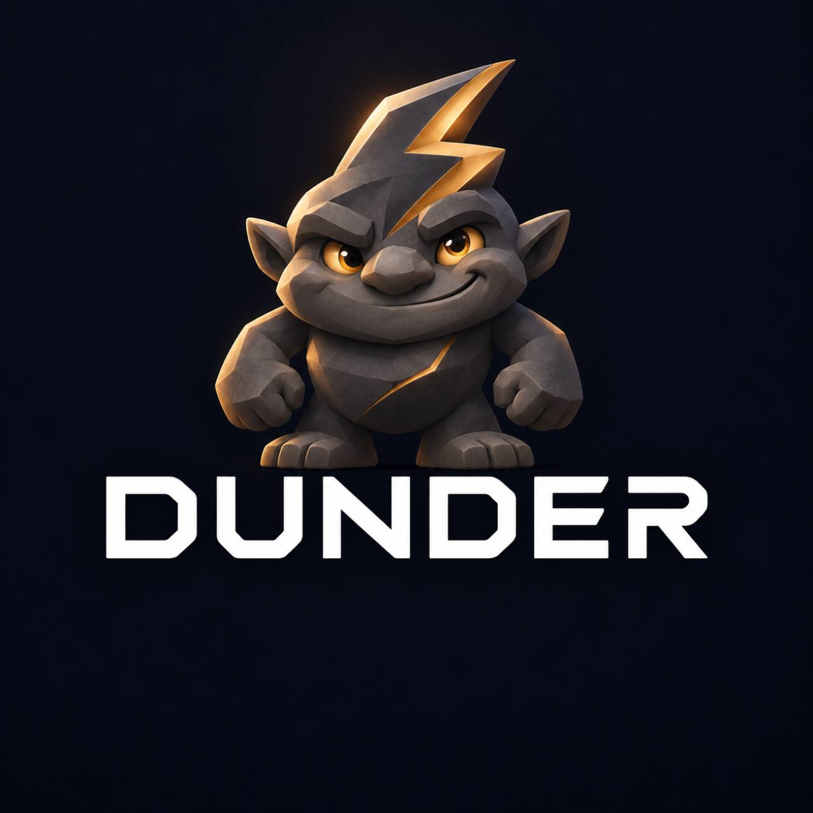

# Dunder ⚡

<p align="center">
  
</p>

Dunder är ett statiskt typat språk med filändelsen `.ddr`. Kompilatorn är
skriven i Dunder och bygger program för ARM64/macOS, ARM64/Linux, x86-64/Linux,
Windows x86-64 (`x86_64-windows`), WebAssembly (`wasm32`) och WASI (`wasm32-wasi`).
Kompilatorn länkar nativa program och signerar macOS-binärer. På macOS och Linux
kan bygget bädda in DWARF-debuginformation med `-g`. Verktygskedjan innehåller
också en formaterare (`dunder fmt`) och en språkserver (`dunder lsp`).

Dunder **0.12.1** finns för ARM64/macOS, ARM64/Linux, x86-64/Linux och
x86-64/Windows. Kompilatorn bygger projekt snabbare genom att packa fasta
heltalsarrayer direkt och läsa igenom färre token vid generisk specialisering.
[Installation och kompatibilitet](docs/releases.md)

```dunder
@test {
    ("Ada") -> "Hej, Ada!"
}
fn greet(name: string) -> string {
    f"Hej, {name}!"
}

fn main() {
    print(greet("världen"))
}
```

## Installera och kör

Agenter som skriver Dunder kan läsa projektets portabla skill. Kopiera katalogen till `.agents/skills/dunder/` i ett annat projekt för att ge dess agenter samma syntaxguide och körbara exempel. [Dunder-skill](.agents/skills/dunder/SKILL.md)

Installera den senaste stabila kompilatorn på ARM64/macOS, ARM64/Linux eller
x86-64/Linux. Standardbiblioteket ingår i binären.

```sh
curl -fsSLo install-dunder.sh https://raw.githubusercontent.com/Mik-pe/dunder/main/tools/install.sh && sh install-dunder.sh --release
export PATH="${DUNDER_HOME:-$HOME/.dunder}/bin:$PATH"
dunder init demo && cd demo
dunder test
dunder run
```

`dunder init demo` skapar programmet `src/main.ddr` och en separat
testrot i `tests/suite.ddr`. Vill du prova hälsningen ovan, spara den i
`src/main.ddr`. Kör `dunder test src/main.ddr` för att testa `greet` och
`dunder run` för att skriva ut `Hej, världen!`.

`dunder run program.ddr` bygger och kör en källfil. Med `dunder build program.ddr -o program`
får du en körbar fil att distribuera. `dunder upgrade` uppdaterar kompilatorn.
[Installationskrav och val av release](docs/releases.md#installera-en-kompilator)

För Windows x86-64 finns en separat `.exe` med kontrollsumma. Releasen
korsbyggs på macOS. Verifiering av hela kompilatorn på Windows återstår.
[Hämta Windowskompilatorn](docs/releases.md#windows-x86-64)

## Bygg från källkod

Projektets release byggs från fröet på ARM64/macOS. Macens kompilator bygger
även Linuxbinärerna, som körs i Kiri. För egna offlinebyggen finns frön
för ARM64/macOS, ARM64/Linux och x86-64/Linux. Kör från repots rot.

```sh
dunder_bin="$(./tools/bootstrap.sh)"
"$dunder_bin" --list-examples
"$dunder_bin" run --example hello
"$dunder_bin" test
```

`examples/hello.ddr` skriver `42` och `true` på varsin rad. Utan filargument använder
`build` och `test` närmaste `dunder.toml`. I det här projektet anger
manifestet det programmet och `tests/suite.ddr` som testrot.
[Projektmanifest och beroenden](docs/dependencies.md)

`dunder run --example` visar projektets exempelnamn. För att få förslag med
Tab i zsh, lägg `eval "$(dunder shim zsh)"` i `~/.zshrc`.
[Körbara exempel och Tab-komplettering](docs/dependencies.md#körbara-exempel)

```sh
"$dunder_bin" check examples/modules/math.ddr
"$dunder_bin" build examples/hello.ddr --target x86_64-linux -o build/hello-linux
```

`check` typkontrollerar snabbt med flera fel, varningar och `--agent`-diagnos.
Alla sex målen kan byggas med samma kompilator. [Målplattformar och körmiljöer](docs/targets.md)
`build --app` paketerar ett ARM64/macOS-program som en signerad `.app`.
[App-paket för macOS](docs/app-bundles.md)

Kör `./tools/install.sh` för att installera den självbyggda versionen i
`$DUNDER_HOME/bin` (förvalt `~/.dunder/bin`).

## Språket och biblioteken

- [Syntax](docs/syntax.md) beskriver funktioner, moduler, traits, råa/flerradiga strängar, `@embed_file`, `&str` och tester. [Små körbara exempel](examples/)
- [Minnesmodellen](docs/memory.md) beskriver ägarskap, flyttar, dynamiska slabs och begränsade lån (`&[]T`, `&str`).
- [Standardbiblioteket](docs/standard.md) innehåller samlingar, strömmar, matematik, serialisering och åtkomst till operativsystemet. [API-nivåer](docs/standard.md#välj-api-nivå) · [Systembibliotek](docs/sys.md) · [TOML](docs/toml.md) · [Kryptografi](docs/crypto.md)
- [Paketen](packages/) ger applikationen [SQLite](docs/sqlite.md), [HTTP-server och HTTP-klient](docs/http.md), [kommandoradsparser](packages/cli/) och [strukturerad loggning](packages/log/).
- [C-FFI](docs/ffi.md) beskriver externa anrop och datalayout. [Parallella uppgifter och synkronisering](docs/tasks.md)

Hundmat är Dunders testbädd. Tabell, HTTP-servern och grafikexemplen för
Metal, Vulkan och WebGPU låter oss prova språket, kompilatorn och
standardbiblioteket i riktiga program. [dunder-hundmat](https://github.com/Mik-pe/dunder-hundmat)

## Kompilatorutveckling

`./tools/dev.sh` gör ett inkrementellt bygge och kör kärntesterna. Kör
`./tools/verify-selfhost.sh` för ett bygge från fröet och kompilatorns ordinarie
verifiering. Testverktygen är skrivna i Dunder. [Testnivåer och systemverktyg](selfhost/README.md#verifiering)

[Guide till kompilatorkoden](selfhost/README.md) · [Arkitekturöversikt](docs/arkitektur.md) · [Bootstrap från frö](bootstrap/README.md) · [Inkrementell kompilering](docs/incremental.md) · [Utvecklingsområden](docs/next-steps.md)
