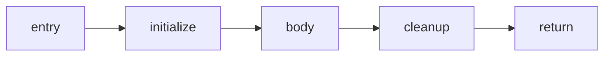

# Nästa steg för ägarlivslängder

Strängoperandpasset och `machine_ir` är implementerade. Detta är planen för
nästa generella steg; analysen nedan är ännu inte implementerad eller mätt.
Målet är att minska bevisat tom cleanup utan att ändra livslängder,
värdesemantik, fällordning eller språkets diagnostik.

Den [gemensamma helfunktions-IR:n](whole-function-ir-plan.md) är nu
huvudspåret. Ägarhändelserna och dataflödeskraven nedan ska inordnas i den
modellen; en fristående ägaranalys som bara kompakterar maskinord är inte
nästa arkitekturleverans.

## En liten representation för ägarhändelser

Behåll `machine_ir` som den enda komponent som ändrar instruktioner och
adresser. Lägg ägarhändelser bredvid instruktionsströmmen. En ägaridentitet
pekar på typ och frameplats; samma plats återanvänds inte för andra ägare
inom funktionen. Händelserna har ordgräns och stabil inbördes ordning.

| Händelse | Tillstånd efter händelsen |
| --- | --- |
| `InitZero` | `Empty` |
| `Install` | `Live` |
| `Take` | `Empty`, efter överföring och nollställning |
| `Clear` | `Empty`, efter avslutad cleanup |
| `UnknownWrite` | `Maybe` |
| `Expose` | Undantagen från första passets omskrivningar |

`Live` anger behov av ägarstädning, inte unik referensräkning. En `Clear`
registrerar också cleanup-spannet och exakt drop-relokering. Redan
lease-eliderade ägare är inaktiva i denna analys.

Registrera händelser i de centrala hjälparna för owner-registrering,
lagring, överföring, cleanup, parameterlagring och prolognollställning.
Frame-skrivningar till registrerade platser måste gå genom en observerad
emitterväg: antingen en preciserad händelse eller `UnknownWrite`.
Utelämnade skrivhändelser kan inte räddas av en senare verifierare.

## Kontrollflöde och dataflöde

Följ verkliga kanter, inte hoppens riktning i filen. Dagens layout placerar
initializerblocket efter kroppen, men körningen är:

Kanten från initializer till body pekar bakåt i maskinorden utan att skapa
en cykel. En modell baserad bara på bakåthopp skulle därför ge fel resultat.

Bygg block från inträde, lokala hoppmål och gränser efter kontrollöverföring.
Symboliska hopp av kind 0 ger en målkant; kind 2–19 ger mål och fallthrough.
Kind 1 är anrop med fallthrough och kind 20 är adressmaterialisering.
Returer och fatala utgångar behöver explicita terminalmarkörer. Okänd
kontrollöverföring undantar funktionen. Verifieraren behöver kontrollera
att varje faktisk kontrollinstruktion har rätt flödesbeskrivning.

Nåbarhet är separat från tillståndet. Endast nåbara föregångare bidrar till
joins. Lika tillstånd behålls, olika tillstånd blir `Maybe`, och `Maybe`
absorberar andra tillstånd. Lokala ägarplatser börjar okända vid inträdet;
först en faktisk initiering bevisar `Empty`. En monoton worklist går till
fixpunkt. Då hanteras loopvillkor som körs flera gånger, `continue`,
`break`, branchjoins och retur som hoppar över statementstädning.

Oexponerade interna frameplatser ändras inte av vanliga anrop. Exponerade
platser, scratch-writeback och osäkra indirekta skrivningar undantas först;
senare stöd kräver en uttrycklig aliasmodell.

## Första omskrivningen och verifieringsgrinden

Börja med interna temporära strängplatser. Om förtillståndet till en
kanonisk `Clear` är `Empty`, ta bort endast dess anrop till release.
Behåll laddningen och nollskrivningen, så att `x0` fortfarande är noll efter
cleanup. Verifiera även register-/flaggkontraktet; ta bort resten av
spannet först när registerliveness finns beskriven.

Sammanfoga nya intervall med leaseintervallen och gör en enda atomisk
`machine_ir.prepare` följd av commits. Budgetstopp kastar bara det nya
passets kandidater. Leaseintervallen måste fortfarande färdigställas,
eftersom deras initiering och cleanup redan har utelämnats av frontend.
Brutna metadata är ett internt fel, inte ett tyst återfall.

Återanvänd block-, kant-, worklist- och tillståndsarrayer mellan funktioner.
Begränsa antal tillståndsceller och debitera verkligt arbete för händelser,
sammanfogningar och kanter. Återställ all nåbarhet och logiska längder även
efter fel. Bygg inga funktionsrecords genom att kopiera ägararrayer.

Inför först händelser, CFG och verifierad analys utan omskrivning. Aktivera
sedan tomma release-borttagningar med separat på/av-läge, samma säkerhetsregler,
native/Wasm-livslängdsprov och 30 vanliga bygg- och runtimeobservationer.
Regressionsfallen måste skilja initializerhoppet från en riktig cykel och
täcka tidig retur, kortslutning, loopåterinträde och återanvänd workspace.
