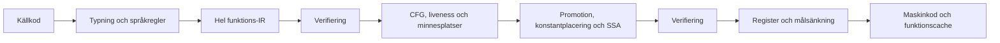

# Gemensam IR för hela funktioner

Målet är C-nära körning och snabb kompilering av hela språket. Fortsättningen
bygger därför på en gemensam funktionsrepresentation. Den tidigare slutna
skalärmodellen och lokala emitterförbättringar räcker inte som huvudarkitektur.
Detta är en genomförandeplan; en verifierad IR-modul är inte i sig ett bevis
för att standardkompilatorn använder den eller att C-målet är uppnått.

## Kedjan

Anrop, ägda värden, flyttal, loopar, tidiga returer och FFI ska rymmas i
samma kedja. En funktions stöd för optimering avgörs av explicita effekter
och bevis, inte av ett andra språkurval som bara accepterar skalära kroppar.
Typkontrollen fortsätter att kontrollera all källkod före omskrivning.

Övergången använder en adapter från den befintliga gemensamma
instruktionsvokabulären. Den gör det möjligt att flytta hela språket genom
gränsen utan att samtidigt skriva om all diagnostik. Adaptern får behålla
ursprungliga kodord för exakt återspelning, men en operation som ändras
måste sänkas från sin kanoniska semantik. Pass får inte avkoda råa ARM-ord
för att upptäcka sina operander eller effekter. Frontend börjar samtidigt
avge explicita minnes- och ABI-kontrakt; på sikt ersätter direkt IR-emission
adaptern. Den gamla direkta maskinkodsvägen ska då avvecklas.

## Milstolpar

1. **Hela språket genom gränsen.** Återanvändbar IR-arena, kontrollflöde,
   explicita operationer, register, flaggor, byteadresserade minnesplatser,
   anropskontrakt och ägareffekter. Sänkning förbereder ändringar atomiskt
   och flyttar etiketter, relokeringar och imports tillsammans. Börja med
   byteidentiska bilder, även för ägarinitiering som ligger efter `RET`.
2. **Register över hela funktioner.** Liveness och verkliga CFG-cykler,
   promotion av oexponerade frameplatser, explicita spill och bevarande av
   register vid anrop och returer. Börja med generella, verifierade
   byteintervall och inför SSA när värdeidentitet och joins behöver det.
   Inget pass får bero på en viss benchmark eller ett funktionsnamn.
3. **Arbete ur looparna.** Dominans, loopstruktur och placeringsanalys för
   konstanter och rena beräkningar. En möjlig fälla, retain, release,
   allokering eller minnesåtkomst får inte flyttas utan ett tillräckligt
   kontrakt. Noll varv och felordning måste bevaras.
4. **Direkta målbackends.** Låt samma värden och ABI-beskrivningar styra
   fysisk registerallokering på ARM64 och x86-64 och lokaler på Wasm.
   Att flytta ARM-register i dagens x86-översättning är inte en färdig
   fysisk x86-allokering. Avveckla övergångsadaptern efter att frontend
   avger hela funktionsmodellen direkt.
5. **Självhosten som användare.** Kompilatorns parser, symboltabeller,
   samlingar och egna IR-pass ska använda vanliga språkfunktioner. Om ett
   nödvändigt uttrycksmedel saknas implementeras det generellt i språket
   och provas genom samma kedja.

Första runtimeleveransen ska angripa trafik över hela loopar. I den faktiska
numeriska benchmarkens framgångsrika varv finns nio frame-läsningar och fyra
frame-skrivningar; C-referensen håller värdena i register. Detta är underlag
för prioriteringen, inte en regel som passet får känna till. Att ta bort
enstaka instruktioner lämnar detta huvudproblem kvar.

## Kontrakt som måste hålla

- Maskinbredd är skild från källtyp: en fysisk W-operation nollutvidgar;
  signerad `i32`-normalisering är en uttrycklig operation. SP och XZR får
  aldrig blandas ihop trots samma kodade registernummer.
- Laddningens utvidgning hör till operationen. Minnesidentitet följer
  byteintervall, överlapp, ursprung och escape. Ett SP-relativt intervall
  är inte automatiskt oberoende av en FP-relativ plats.
- Anropets resultatdefinitioner är skilda från register som kan förstöras.
  Intern Dunder-ABI, runtimehjälpare, C-ABI och värdanrop behöver egna
  kontrakt. Nya registerhem kräver uttryckligt bevarande.
- CFG följer exekveringskanter. Ett bakåthopp från ägarinitiering till
  kroppen är ingen loop. Okänd kontrollöverföring ger en okänd kant och
  spärrar analyser som saknar tillräcklig information.
- Flagganvändning, utvärderingsstack, frame, fällor och cleanup behåller
  sin ordning. Endast bevisat giltiga minnesåtkomster kan vara fällfria.
- Kontrollbyggen behöver ingen backend-arena. Cacheträffar återställer
  slutligt sänkta fragment; de ska inte optimeras en andra gång. IR-version,
  mål och passpolicy ingår i cache- och testidentitet.

## Kompileringstid och acceptans

Använd återanvändbara platta arenor, stabila ID:n och begränsat arbete per
funktion. Analyser ska besöka den aktuella funktionen och dess kanter;
upprepade genomsökningar av tidigare funktioner ger en kvadratisk kedja.
En arbetsbudget får avstå en frivillig optimering, medan trasiga metadata
är ett internt kompilatorfel. Bygg inte små heapobjekt per instruktion.

Mät vid sammanhängande milstolpar: fasta vanliga runtimeprogram mot C,
kompilatorns egna arbetslaster, kallt genererat bygge, självbygge och
inkrementella ändringar. Behåll samma indata, fällkontroller och C-flaggor.
Redovisa fördelning och total byggtid; profilerade delklockor är attribution,
inte vanlig latens. En snabb liten testfunktion ersätter inte det faktiska
programmet som fortfarande tappar prestanda.

[Prestandakontraktet](prestanda.md) gäller samma standardprofil för båda
egenskaperna: minst 100 000 källrader/s vid p95 för rent bygge, C-geomedel
högst 1,10× och inget enskilt runtimefall över 1,25×. De föreslagna
interaktiva målen är p95 högst 50 ms utan ändring och 100 ms efter en
privat funktionsändring. De är acceptansmål, inte uppnådda resultat.

Första grinden är korrekt genomförd helfunktionskedja med oberoende
differentialprov och verifierad självhostfixpunkt. Nästa grind kräver att
den nya register- och placeringsmodellen förbättrar representativa program
och fortfarande klarar kompileringstidsmålet. En ny arkitektur får kosta
arbete; den måste också förklara och mäta vart arbetet går. Cacheformat och
processdiagnostik fortsätter som separata uppgifter och styr inte denna
leverans.

## Exklusiv transaktionsgräns

Den tidigare analyze/apply-vägen med en full funktionsplan och exakta
snapshots är ersatt i värdepasset. En publik
`optimize_with_context(work, &mut function, context)` håller det exklusiva
lånet genom hela transaktionen. Arbetsminnet återanvänds mellan funktioner.

Analysen läser originalet till fixpunkt. Stagning sparar endast ändrade
operationsrader i en gles undo-arena; rena raderingar behöver bara sitt
ursprungliga mode. Stabil ordning, platser, etiketter och CFG kopieras inte.
Originalraden överför värdefakta innan dess ersättning skrivs. Verifiering
och liveness läser sedan den faktiska stagade representationen. Normala
avslag återställer samtliga ändrade rader samt verified/optimizable; ingen
delvis optimerad funktion lämnar det exklusiva lånet.

Verifierarens seen-scratch ligger i dess eget arbetsminne, så modellens
övriga metadata förblir orörda. En snäv bevisbevarande regel låter DCE
behålla ett redan giltigt certifikat när enbart mode ändras för rena
Const/Copy/MOVK. Ingen allmän validering hoppas över: semantiska ersättningar
verifieras efter replay, och varje ändrat slutresultat fullverifieras
ovillkorligen. Hela det reserverade verifierings- och rollbackarbetet
debiteras. Budgetavslag efter stagning ska återställa exakt samtliga fält.

Detta angriper kompileringskostnaden utan att ändra de valda
målinstruktionerna. Nästa runtimeetapp behöver verklig värde-SSA och
registerallokering för privata skalärplatser, smala läsvyer och
uttrycksstackvärden. Återanvändning av heaplaster behöver dessutom
adressidentitet och explicita minnesversioner; scalar-SSA ensam bevisar
inte att två heapåtkomster är oberoende.
