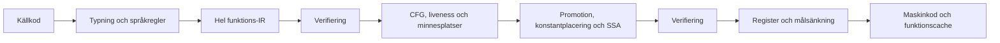

# Gemensam IR för hela funktioner

Målet är C-nära körning och snabb kompilering av hela språket. Fortsättningen
bygger därför på en gemensam funktionsrepresentation. Den tidigare slutna
skalärmodellen och lokala emitterförbättringar räcker inte som huvudarkitektur.
Detta är en genomförandeplan; en verifierad IR-modul är inte i sig ett bevis
för att standardkompilatorn använder den eller att C-målet är uppnått.

## Kedjan

Anrop, ägda värden, flyttal, loopar, tidiga returer och FFI ska rymmas i
samma kedja. En funktions stöd för optimering avgörs av explicita effekter
och bevis, inte av ett andra språkurval som bara accepterar skalära kroppar.
Typkontrollen fortsätter att kontrollera all källkod före omskrivning.

Övergången använder en adapter från den befintliga gemensamma
instruktionsvokabulären. Den gör det möjligt att flytta hela språket genom
gränsen utan att samtidigt skriva om all diagnostik. Adaptern får behålla
ursprungliga kodord för exakt återspelning, men en operation som ändras
måste sänkas från sin kanoniska semantik. Pass får inte avkoda råa ARM-ord
för att upptäcka sina operander eller effekter. Frontend börjar samtidigt
avge explicita minnes- och ABI-kontrakt; på sikt ersätter direkt IR-emission
adaptern. Den gamla direkta maskinkodsvägen ska då avvecklas.

## Milstolpar

1. **Hela språket genom gränsen.** Återanvändbar IR-arena, kontrollflöde,
   explicita operationer, register, flaggor, byteadresserade minnesplatser,
   anropskontrakt och ägareffekter. Sänkning förbereder ändringar atomiskt
   och flyttar etiketter, relokeringar och imports tillsammans. Börja med
   byteidentiska bilder, även för ägarinitiering som ligger efter `RET`.
2. **Register över hela funktioner.** Liveness och verkliga CFG-cykler,
   promotion av oexponerade frameplatser, explicita spill och bevarande av
   register vid anrop och returer. Börja med generella, verifierade
   byteintervall och inför SSA när värdeidentitet och joins behöver det.
   Inget pass får bero på en viss benchmark eller ett funktionsnamn.
3. **Arbete ur looparna.** Dominans, loopstruktur och placeringsanalys för
   konstanter och rena beräkningar. En möjlig fälla, retain, release,
   allokering eller minnesåtkomst får inte flyttas utan ett tillräckligt
   kontrakt. Noll varv och felordning måste bevaras.
4. **Direkta målbackends.** Låt samma värden och ABI-beskrivningar styra
   fysisk registerallokering på ARM64 och x86-64 och lokaler på Wasm.
   Att flytta ARM-register i dagens x86-översättning är inte en färdig
   fysisk x86-allokering. Avveckla övergångsadaptern efter att frontend
   avger hela funktionsmodellen direkt.
5. **Självhosten som användare.** Kompilatorns parser, symboltabeller,
   samlingar och egna IR-pass ska använda vanliga språkfunktioner. Om ett
   nödvändigt uttrycksmedel saknas implementeras det generellt i språket
   och provas genom samma kedja.

Första runtimeleveransen ska angripa trafik över hela loopar. I den faktiska
numeriska benchmarkens framgångsrika varv finns nio frame-läsningar och fyra
frame-skrivningar; C-referensen håller värdena i register. Detta är underlag
för prioriteringen, inte en regel som passet får känna till. Att ta bort
enstaka instruktioner lämnar detta huvudproblem kvar.

## Kontrakt som måste hålla

- Maskinbredd är skild från källtyp: en fysisk W-operation nollutvidgar;
  signerad `i32`-normalisering är en uttrycklig operation. SP och XZR får
  aldrig blandas ihop trots samma kodade registernummer.
- Laddningens utvidgning hör till operationen. Minnesidentitet följer
  byteintervall, överlapp, ursprung och escape. Ett SP-relativt intervall
  är inte automatiskt oberoende av en FP-relativ plats.
- Anropets resultatdefinitioner är skilda från register som kan förstöras.
  Intern Dunder-ABI, runtimehjälpare, C-ABI och värdanrop behöver egna
  kontrakt. Nya registerhem kräver uttryckligt bevarande.
- CFG följer exekveringskanter. Ett bakåthopp från ägarinitiering till
  kroppen är ingen loop. Okänd kontrollöverföring ger en okänd kant och
  spärrar analyser som saknar tillräcklig information.
- Flagganvändning, utvärderingsstack, frame, fällor och cleanup behåller
  sin ordning. Endast bevisat giltiga minnesåtkomster kan vara fällfria.
- Kontrollbyggen behöver ingen backend-arena. Cacheträffar återställer
  slutligt sänkta fragment; de ska inte optimeras en andra gång. IR-version,
  mål och passpolicy ingår i cache- och testidentitet.

## Kompileringstid och acceptans

Använd återanvändbara platta arenor, stabila ID:n och begränsat arbete per
funktion. Analyser ska besöka den aktuella funktionen och dess kanter;
upprepade genomsökningar av tidigare funktioner ger en kvadratisk kedja.
En arbetsbudget får avstå en frivillig optimering, medan trasiga metadata
är ett internt kompilatorfel. Bygg inte små heapobjekt per instruktion.

Mät vid sammanhängande milstolpar: fasta vanliga runtimeprogram mot C,
kompilatorns egna arbetslaster, kallt genererat bygge, självbygge och
inkrementella ändringar. Behåll samma indata, fällkontroller och C-flaggor.
Redovisa fördelning och total byggtid; profilerade delklockor är attribution,
inte vanlig latens. En snabb liten testfunktion ersätter inte det faktiska
programmet som fortfarande tappar prestanda.

[Prestandakontraktet](prestanda.md) gäller samma standardprofil för båda
egenskaperna: minst 100 000 källrader/s vid p95 för rent bygge, C-geomedel
högst 1,10× och inget enskilt runtimefall över 1,25×. De föreslagna
interaktiva målen är p95 högst 50 ms utan ändring och 100 ms efter en
privat funktionsändring. De är acceptansmål, inte uppnådda resultat.

Första grinden är korrekt genomförd helfunktionskedja med oberoende
differentialprov och verifierad självhostfixpunkt. Nästa grind kräver att
den nya register- och placeringsmodellen förbättrar representativa program
och fortfarande klarar kompileringstidsmålet. En ny arkitektur får kosta
arbete; den måste också förklara och mäta vart arbetet går. Cacheformat och
processdiagnostik fortsätter som separata uppgifter och styr inte denna
leverans.

## Exklusiv transaktionsgräns

Den tidigare analyze/apply-vägen med en full funktionsplan och exakta
snapshots är ersatt i värdepasset. En publik
`optimize_with_context(work, &mut function, context)` håller det exklusiva
lånet genom hela transaktionen. Arbetsminnet återanvänds mellan funktioner.

Analysen läser originalet till fixpunkt. Stagning sparar endast ändrade
operationsrader i en gles undo-arena; rena raderingar behöver bara sitt
ursprungliga mode. Stabil ordning, platser, etiketter och CFG kopieras inte.
Originalraden överför värdefakta innan dess ersättning skrivs. Verifiering
och liveness läser sedan den faktiska stagade representationen. Normala
avslag återställer samtliga ändrade rader samt verified/optimizable; ingen
delvis optimerad funktion lämnar det exklusiva lånet.

Verifierarens seen-scratch ligger i dess eget arbetsminne, så modellens
övriga metadata förblir orörda. En snäv bevisbevarande regel låter DCE
behålla ett redan giltigt certifikat när enbart mode ändras för rena
Const/Copy/MOVK. Även de befintliga smala skalära aliasomskrivningarna
kan behålla ett redan sant certifikat efter samma lokala radkontrakt.
FP/SP eller annan obevisad ändring tar full verifieringsväg efter replay.
Varje ändrat slutresultat fullverifieras ovillkorligen. Hela det reserverade verifierings- och rollbackarbetet
debiteras. Budgetavslag efter stagning ska återställa exakt samtliga fält.

Detta angriper kompileringskostnaden utan att ändra de valda
målinstruktionerna. Nästa runtimeetapp behöver verklig värde-SSA och
registerallokering för privata skalärplatser, smala läsvyer och
uttrycksstackvärden. Återanvändning av heaplaster behöver dessutom
adressidentitet och explicita minnesversioner; scalar-SSA ensam bevisar
inte att två heapåtkomster är oberoende.

## Parallell kompilering och språkets trådar: nästa etapp

Status: språk/runtime-delen nedan är en genomförandeplan, inte ett befintligt
thread-API. En ägd, relokerbar `FunctionObject` är implementerad och verifierad med
samma sänkare i den seriella kedjan; den inför inte trådar i sig.

Den första kompilatorkonsumenten ska vara bearbetning av hela funktions-IR:er.
Frontend behåller sin ordning för symboler, nåbarhet, diagnostik och
inlinebudgetar. Varje worker äger en MIR-funktion och egna återanvändbara
verifierings-/analys-/sänkningsarenor. Den returnerar ord, lokala etikett-
offsetar, symboliska globala ID:n, importplatser och statistik. En koordinator
sammanfogar efter jobbens ursprungliga ordningsnummer. Bunden kö begränsar
antalet levande funktionsarenor. Varken Compiler, global Code eller cache-I/O
delas muterbart mellan workers. Parallell modulläsning/lexning kan följa;
parallella funktionsfronter kräver först en frusen deklarationsvärld och
separata FunctionContext.

Språkets första vertikal ska vara strukturerade, isolerade uppgifter med
namngiven workerfunktion, ett explicit indatavärde och ett typat resultat.
Det lexikala scopet äger alla OS-jobb, snapshots, resultat och cleanup.
Spawn lämnar en kopierbar typad TaskID<Result>: en resultatnyckel, aldrig
en ägarpekare. Därmed kräver första modellen inte generell move-kontroll
eller affina taskhandtag. Den generella typkonstruktorn behöver inte vänta
på fulla användargenerics. Nycklar kan lagras som skalära värden i arrayer,
så kompilatorn kan hålla en begränsad FIFO utan arrayer av aggregat.

Await kräver ett levande matchande scope och kontrollerar ägare, generation,
ordinal och resultattyp. En utgången eller felaktig nyckel får inte
dereferera frigjort kontrollminne. Generationer får inte återanvändas vid
overflow. Scopet joinar varje jobb internt exakt en gång och cachelagrar
resultatet i föräldraheapen; upprepade await ger vanliga värdekopior av den
cachen. Normal scope-exit väntar in alla jobb före cleanup, även vid
return/break/continue. Ingen detach, polling utan atomics eller cancellation
införs först. Scopets kapabilitet får inte lämna sin region.

Första datagränsen definieras av den faktiska klonvägen: en tillåten
värdekopia får aldrig dela managed-handtag. Primitiver och tag-enums utan
payload fungerar; ägda arrayer och records måste uppfylla samma regel
rekursivt. Dynamiska strängar och payload-enums avvisas först, även när
en enum bara innehåller tal: dagens klonväg behåller hela enumblocket med
retain. Borrows, scratch-vyer, råpekare, okända funktionspekare och task-ID:n
får inte passera jobbgränsen. Opaque- och resurskontrakt måste granskas
separat; ett OS-handtag kan döljas i ett heltal. Detta är inte ett generellt
Send/Sync-anspråk för alla befintliga typer.

Varje worker får en egen runtimekontext, heap och separat C-ABI-entry.
Föräldern måste först skapa en fristående inputsnapshot som hålls levande
till join. Child får läsa denna som lånad rå källa och klona till sin egen
pool; förälderns snapshot får aldrig bli ett ägt workerargument som kan
frigöras av child. Workeranropet får enbart den färdiga childkopian.
Resultatroten måste leva efter workerfunktionens cleanup. Efter lyckad join
klonar föräldern resultatet före återvinning av childpoolen och använder
aldrig vanlig parent-release på childallokeringar.

All childläst kontrollinformation färdigställs före thread-create; allt
childskrivet resultat läses först efter join. Create/join måste vara riktiga
synkroniserande minnesgränser. Nullpool för skalärjobb och initiering av
profilräknare behöver egna prov. Misslyckad create skapar inget joinbart
jobb; misslyckad join bevisar inte att child är färdig och får därför inte
leda till frigöring. Spawnfel måste lämna redan startade jobb registrerade
för korrekt scope-cleanup.

Workerfunktionens transitiva effekter verifieras: inga externa anrop,
static_bytes, råa escaping-adresser, callbacks eller okända indirekta
anropsmål. Interna lån och allokering i den egna domänen är tillåtna. Ett
vanligt fn(T)->R bevisar inte denna effektgräns. Nested spawn avstår först
eller måste dela en hierarkisk trådbudget. Dynamiska strängar/payload-enums
kan följa med verklig gränsdjupkopiering; nollkopierande flytt och delad heap
kräver sedan egna regler för remote-free, poollivstid, atomisk RC och
Send/Sync/lånelivstider. De är separata utbyggnader.

Den befintliga callbackbryggan är uttryckligen synkron och trådbunden och
får inte återanvändas som workerstart. Native-adaptern behöver sätta upp
heapregister samt x86:s registerbank/värdestack och bevara värdens C-ABI.
Wasm behöver en egen worker-/instans- och transportgräns; nåbar threading
ska tills dess ge ett tydligt målrelaterat fel. Isolerade WebWorkers med
separata instanser och typat wire-format behöver inte dela linjärt minne
eller använda atomics; delat minne är ett separat alternativ. Bootstrap ska fortsatt byggas från
den frysta seriella seedvägen; en compiler som själv använder nya task-
uttryck måste byggas i ett uttryckligt senare steg, inte kräva att fröet
redan förstår den nya syntaxen.

Acceptansgrindar: data-/alias-/resursprov över spawn/join och alla scope-
utgångar; worker-/start-/joinfel med korrekt cleanup; separata heapar och
resultatlivstid; identiska bilder, bindings, diagnostik och cacheutfall med
1/2/N workers och varierad färdigordning. Mät en worker och standardantal
separat, inklusive kopiering, kö, merge, signering och toppminne. Trådantal
får inte ändra optimeringsbudgetar eller programmets semantik.

Implementerad första grund (fortfarande utan källsyntax): `task_data.ddr`
kontrollerar den rekursiva klondomänen mot semantisk typmetadata och
`task_effects.ddr` beräknar transitiveffekter över en förseglad anropsgraf.
Okänd/inaktuell metadata får inte återanvändas som bevis. Primitiv-ID:n
översätts uttryckligen; kompletta tag-enums kräver icke-tomma unit-varianter.
`task_native.ddr` genererar en separat C-ABI-entry för ARM64/macOS med egen
barnpool, pthread create/join och föräldraklonat resultat före poolreklamering.
Fel ger explicita ägartillstånd; join-fel får aldrig följas av läsning eller
frigöring av barnets lagring. Riktiga OS-jobb, ABI och felvägar provas lokalt.
Syntax, lexikal scope-scheduler och parallell kompilering är ännu inte aktiverade.
Den valda språkytan under implementation är `task scope jobs(4)`,
`spawn jobs worker(input)` och `await jobs(id)`, med strukturellt typad
`TaskID<Result>`. Kapaciteten begränsar aktiva jobb. En enda utfärdare i
föräldraruntimen ger nycklar med generation i höga 32 bitar och ordinal i
låga 32 bitar. Gränserna kontrolleras före overflow; generationer återanvänds
aldrig. Scope, generation, ordinal och exakt resultattyp kontrolleras innan
kontrollblocket får läsas. Opaque-typer avvisas i första källvertikalen tills
en uttrycklig definitionsägd klassificering finns.
